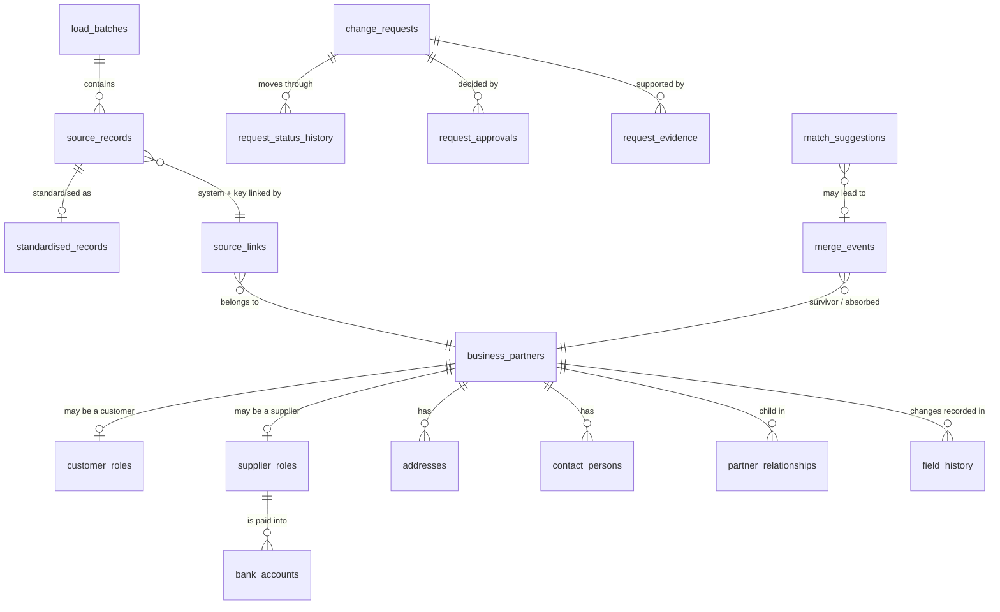

# Database design (MDH-003)

Tables, relationships, history and integrity rules of the MoP Master Data Hub database.
Every column is described in [data_dictionary.md](data_dictionary.md). The rules this database
supports are in [data_standards.md](data_standards.md), [quality_rules.md](quality_rules.md)
and [`rules/MDH-RULES-v1.5.json`](../rules/MDH-RULES-v1.5.json).

**Status:** implemented and tested. `SQL/001_create_schema.sql` creates the 25 tables and the
rules below, `SQL/002_working_minutes.sql` adds the working-time function, `SQL/003_rules_v1_2.sql`
allows the M1B suggestion (rules v1.2), and `SQL/tests/`
holds 13 test files that prove each rule refuses bad data (see [How to run the tests](#how-to-run-the-tests)).

**Rules v1.3 (migration `SQL/004_rules_v1_3.sql`):** block reasons `insolvency` and `absorbed`,
the `successor_of` link, contact status with last verification and last contact, VIES status,
supplier last activity, payee type and holder-name outcome, the registry and HR reference
extracts, rule exceptions, the suppression list and the `hub.partner_names` view. Integrity
rules I21–I24 below; test file `014_test_rules_v1_3.sql`. The database now has 29 tables and
one view. Migration `SQL/005_rules_v1_5.sql` (rules v1.5, G9) keeps the group tier unknown while a
partner's own tier is unknown; test file `015_test_rules_v1_5.sql`.

## Design approach

The database keeps three things apart, so each can be explained on its own:

| Layer | Question it answers | Where |
|---|---|---|
| What arrived | What did each system send, and when? | `source` |
| What we agreed | What is the one correct version of this company today? | `hub` (partners, roles, addresses, bank accounts, contacts, hierarchy) |
| How we got there | Why does the golden record say this, who decided, and what was true on a given date? | `hub.source_links`, `hub.field_history`, `governance` |

**Why keep source records separately and unchanged?** A golden record is a conclusion. If the
evidence it was built from is overwritten, the conclusion can no longer be checked, a wrong
merge cannot be undone, and reconciliation with the source systems is impossible. So every
record is kept exactly as received, and a change in a source system arrives as a new version.

**Why current values plus one history table (D10)?** The steward, the engine and the reports
mostly need *today's* value, so typed current tables keep queries and constraints simple. What
an auditor and an undo-merge need is the *story of each field*: its old and new value, when it
applied, and whether it came from a source record, an approved request or a merge. One
`field_history` table holds that story for every governed field, with its lineage, and lets any
report be rebuilt as of a past date.

**Why does the database enforce rules at all, when the engine checks them too?** Because data
can arrive from more than one place: the engine, a steward's correction, a migration script,
a test. A rule enforced only in code is broken the first time something else writes to the
table. The database refuses anything structurally wrong; the engine applies the rules that need
the rules file (check digits, matching, survivorship) or several rows at once.

## Schemas

| Schema | Holds | Written by | Read by `mdh_reporting` |
|---|---|---|---|
| `config` | Rules versions, source systems, staff and their roles, the working-time function | Setup scripts, engine | Yes |
| `source` | Load batches, source records as received, their standardised values | Loader and engine | No (A01) |
| `hub` | Golden partners, roles, addresses, bank accounts, contacts, hierarchy, cross-reference, field history | Engine, request workflow | Yes, without personal or bank details (A02, A03) |
| `governance` | Quality runs and results, match suggestions, merges, requests, approvals, evidence, erasure proofs | Engine, request workflow | Yes |

dbt adds a `reporting` schema in MDH-009.

## Tables

| Schema | Table | One row represents |
|---|---|---|
| config | `rule_versions` | One loaded version of the rules file |
| config | `source_systems` | One source system |
| config | `staff` | One MoP Cloud person |
| config | `staff_roles` | One period in which a person holds a governance role |
| source | `load_batches` | One extract or file load |
| source | `source_records` | One version of one record in one source system |
| source | `standardised_records` | The standardised values of one source record version |
| hub | `business_partners` | One golden business partner |
| hub | `customer_roles` | The customer role of one partner |
| hub | `supplier_roles` | The supplier role of one partner |
| hub | `addresses` | One address of one partner for one period |
| hub | `bank_accounts` | One period in which a supplier uses one bank account |
| hub | `contact_persons` | One contact person of one partner |
| hub | `partner_relationships` | One period in which a partner has a parent |
| hub | `source_links` | One period in which a source record belongs to a partner |
| hub | `field_history` | One change of one governed field |
| governance | `quality_runs` | One run of the quality rules |
| governance | `quality_results` | One rule checked on one subject in one run |
| governance | `match_suggestions` | One pair of records that may be the same company |
| governance | `merge_events` | One merge, or the undo of one |
| governance | `change_requests` | One request |
| governance | `request_status_history` | One status change of one request |
| governance | `request_approvals` | One approval decision |
| governance | `request_evidence` | One piece of evidence (reference and checksum only) |
| governance | `erasure_proofs` | One completed erasure of a contact person |
| source | `registry_entries` | One company's status in one registry extract (simulated; v1.3) |
| source | `hr_employees` | One employee in one synthetic HR extract, for the employee–supplier match (v1.3) |
| governance | `rule_exceptions` | One approved exception to a rule for one partner, for a period: K03 exceptions, K10 clearances (v1.3) |
| governance | `suppression_list` | One erased or opted-out email, kept only as a hash (v1.3) |
| hub | `partner_names` (view) | Current and former names of each partner, for matching (v1.3) |

## Main relationships



- A source record (its system and key) belongs to exactly one partner at any moment; all its
  versions follow that link. A partner can have many source records, from several systems.
- A partner has at most one customer role and one supplier role; a company that is both has
  both rows and one set of general data.
- Bank accounts belong to the supplier role, so a partner without a supplier role cannot have one.
- A partner has at most one parent at a time; the parent chain is at most five levels deep.
- Every request has a requester, a status history, and zero or more approvals and evidence rows.
- Every field change, quality result, link and suggestion names the rules version that produced it.

## How the key questions are answered

**Which partner is this source record?** The current link for its system and key:

```sql
SELECT bp_id
FROM hub.source_links
WHERE system_code = 'erp' AND source_key = 'C-10442'
  AND upper_inf(valid_period);
```

**Where did a golden value come from?** The latest history row for the field, with its lineage:

```sql
SELECT new_value, valid_from, source_record_id, request_id, merge_event_id, survivorship_step
FROM hub.field_history
WHERE bp_id = 'BP-000123' AND field_name = 'legal_name'
ORDER BY valid_from DESC, history_id DESC
LIMIT 1;
```

**What was true on a past date?** The same query with `valid_from <= :as_of`. This is what
lets MDH-009 rebuild any KPI as of any date.

**What is the whole group?** The hierarchy read top-down with a recursive query:

```sql
WITH RECURSIVE grp AS (
    SELECT bp_id, NULL::text AS parent_bp_id, 1 AS level
    FROM hub.business_partners
    WHERE bp_id = 'BP-000010'
  UNION ALL
    SELECT r.child_bp_id, r.parent_bp_id, g.level + 1
    FROM hub.partner_relationships r
    JOIN grp g ON r.parent_bp_id = g.bp_id
    WHERE upper_inf(r.valid_period)
)
SELECT * FROM grp;
```

## Merge and undo

A merge never deletes anything:

1. A `merge_events` row records survivor, absorbed partner, reason, approver and the suggestion
   or request behind it.
2. Every current link of the absorbed partner is closed (its period ends) and reopened on the
   survivor, with `link_method = 'merge'` and the merge event ID.
3. The absorbed partner gets status `merged` and points to the survivor. Its rows (roles,
   addresses, contacts) stay where they are, for history.
4. Survivorship recalculates the survivor's fields; each change goes to `field_history` with the
   merge event as lineage.

An undo is a new `merge_events` row of type `undo` that points to the merge it reverses. The
links that merge moved are found by its merge event ID, closed on the survivor and reopened on
the absorbed partner, which becomes `active` again. Field changes caused by the merge are
reversed from `field_history`. Nothing has to be guessed, because every step left a row.

## Erasure of a contact person (D11)

One database function, `governance.erase_contact()`, does the whole erasure in one transaction:

1. Clears the personal fields of the `contact_persons` row and marks it `erased`.
2. Replaces the person's fields with a marker in every stored source record version that holds
   them, and sets `redacted_at` and `redaction_request_id`. This is the only path allowed to
   change a source record (I02).
3. Adds the SHA-256 of the lower-cased email to `governance.suppression_list` (rules v1.3), so the
   person cannot be stored again as a contact (I21).
4. Writes an `erasure_proofs` row: request, contact ID, partner, number of versions redacted and
   systems affected. It holds none of the erased data.

The content hash of each redacted version is kept, so loading an old extract again cannot bring
the erased data back: it matches a stored version and is skipped (I03). A *new* extract that
still contains the person is a sign the source system was not cleaned; the engine flags it to
the DPO.

## Integrity rules enforced by the database

| ID | Rule | How |
|---|---|---|
| I01 | Every script runs only against `mop_mdh` or `mop_mdh_test` | Guard block at the top of each script |
| I02 | Source records are insert-only; only the erasure function may redact them | Trigger refusing UPDATE and DELETE unless `governance.erase_contact()` has set `mdh.erasure_in_progress` for its own transaction; even then only the payload and the two redaction columns may change |
| I03 | Loading the same version of a source record twice stores it once | Unique (system, source key, content hash); unique (system, file checksum) on load batches |
| I04 | A source record belongs to exactly one partner at any moment | `EXCLUDE USING gist` on (system, source key, valid period) in `source_links`; trigger checking the record exists |
| I05 | Partner IDs follow `BP-NNNNNN`, come from a sequence and are never deleted | Format CHECK, sequence default, trigger refusing DELETE |
| I06 | A merged partner points to an active survivor other than itself; an active partner points to none; a survivor cannot itself be merged while others point to it | CHECK on status, pointer and merge time; FK; trigger checking the survivor |
| I07 | One active partner per country and tax ID | Partial unique index where status is `active` (rule U01) |
| I08 | The VAT number is derived, never typed | Generated column: ES and PT prefix + tax ID; FR prefix + key + SIREN |
| I09 | Formats: country code, tax ID per country (ES, PT, FR), postal code per country, web domain, email, phone, IBAN length per country | CHECK constraints. Check digits are verified by the engine (V01, V09) |
| I10 | At most one customer role and one supplier role per partner; stages and tiers from the allowed lists; a known tier has its score; the group tier is never lower than the partner's own tier and is unknown while its own tier is unknown (G9); a tier override always names its request; the effective tier is never typed | Primary key on partner ID in each role table; CHECKs on stage, tiers, score and override pair; generated column |
| I11 | A block has a reason, an approver and a time, or none of them | CHECK `num_nulls(...) IN (0, 3)` on both role tables (rule K07) |
| I12 | One parent at a time, never itself, no loop, at most five levels | `EXCLUDE` on overlapping periods; CHECK; trigger with a recursive query (rule K05) |
| I13 | One current bank account per supplier; verification date, method and verifier filled together | `EXCLUDE` on overlapping periods; CHECK; FK to `supplier_roles` |
| I14 | An erased contact has no personal data and has an erasure time; any other contact (active, left the company, bouncing) has a name and a work email | CHECK |
| I15 | History tables are append-only | Trigger refusing UPDATE and DELETE on `field_history`, `request_status_history`, `request_approvals`, `merge_events`, `quality_results`, `erasure_proofs` |
| I16 | Every field-history row names its lineage | CHECK `num_nonnulls(source_record_id, request_id, merge_event_id) >= 1` |
| I17 | A suggestion stores its pair in a fixed order; at most one open suggestion per pair; a decided one has a decider and a time | CHECK on row order; partial unique index; CHECK |
| I18 | Nobody approves a request they raised | Composite FK (request, requester) from `request_approvals` to `change_requests`; CHECK approver ≠ requester |
| I19 | A person holds the same role in non-overlapping periods only | `EXCLUDE` on `staff_roles` |
| I20 | Every quality result, link, suggestion, merge and field change names a loaded rules version | FK to `config.rule_versions` |
| I21 | A person on the suppression list cannot be stored again as a contact, in any letter case (rule U04) | Trigger comparing the SHA-256 of the lower-cased email; the erasure function adds the hash |
| I22 | Bank details paid to a factoring company or alternative payee have an assignment letter; own-account details have none | CHECK |
| I23 | VIES status, check date and evidence are filled together | CHECK `num_nulls(...) IN (0, 3)` |
| I24 | One successor at a time; the successor is active and has not itself been absorbed; successor links do not count in the hierarchy (I12) | `EXCLUDE` on child, link type and period; trigger |

## Access rules

| ID | Rule | How |
|---|---|---|
| A01 | `mdh_reporting` can read `config`, `hub` and `governance`, and cannot read `source` or write anywhere | Schema `USAGE` and `SELECT` grants only; no grant on `source` |
| A02 | `mdh_reporting` cannot read personal or bank details, including inside JSON columns | Column-level grants: `hub.contact_persons` without names, email and role; `hub.bank_accounts` without IBAN and holder name; `change_requests` without `proposed_values`, `match_suggestions` without `compared_values`, `quality_results` without `details` |
| A03 | `mdh_reporting` cannot read the history of personal or bank fields | Row-level security on `hub.field_history` hiding rows for `iban` and `account_holder_name` |

Rules v1.3 keeps the same principle: the registry and HR extracts sit in `source`, so reporting
cannot read them (A01); the suppression list has no reporting grant; reporting sees payee type,
holder-match outcome and contact dates, but not exception details.

Reports count bank accounts and contacts and show their quality, but never the details. That is
the GDPR principle of data minimisation applied to reporting. `mdh_reporting` is a role without
login; a login for dbt and Power BI is added in MDH-009.

## What the engine enforces, not the database

These need the rules file or several rows at once, and are covered by tests and later by
reconciliation checks:

- Check digits of tax IDs and IBANs (V01, V09); free email domains and placeholders (V05, V11).
- Mandatory fields per lifecycle stage (C01): what is mandatory changes with the stage.
- Matching, survivorship and which values go on the golden record.
- Valid request status transitions, evidence per request type, and that the approver held the
  right role at the time of the decision.
- That an absorbed partner's links all moved, and that merges and undos balance.

## Known limits

- No public holidays in working time, the same as LeadFlow.
- One database role for the engine and the request workflow (the table owner). Separate write
  roles per component are a later improvement.
- The erasure switch (`mdh.erasure_in_progress`) protects source records from mistakes, not from
  an administrator who sets it on purpose; a production system would give the erasure function
  its own role.
- Erasure finds a person by work email anywhere in the stored payload, in any letter case. A
  record that names the person without the email address is not found.
- Erasure removes the person from the hub and its stored copies only. Erasing them in the source
  systems themselves is a task for those systems' owners; the hub flags when it comes back.
- Evidence documents are not stored, only references and checksums.
- Standardised values (`source.standardised_records`) are not format-checked, on purpose: a
  value can be standardised and still invalid, and the quality rules must be able to report it.

## How to run the tests

From the repo root, with PostgreSQL running and `~/.pgpass` set up (as for LeadFlow):

```
SQL/tests/run_all_tests.sh --rebuild
```

This drops and recreates `mop_mdh`, checks that the schema refuses any other database (I01),
applies every migration in number order and runs each test file in its own transaction, rolled
back at the end. The summary shows each file with its number of checks, and a log is written to
`docs/evidence/`. Without `--rebuild`, the tests run against the existing database.

| Test file | Covers |
|---|---|
| `001_test_config.sql` | Rules versions, source systems, staff, roles (I19) |
| `002_test_source.sql` | Load batches, source records, standardised values (I02, I03) |
| `003_test_partners.sql` | Partner IDs, merges, tax IDs, VAT numbers, formats (I05–I09) |
| `004_test_roles.sql` | Customer and supplier roles, customer tier, blocks (I10, I11) |
| `005_test_addresses_bank_contacts.sql` | Addresses, bank accounts, contact persons (I09, I13, I14) |
| `006_test_hierarchy.sql` | One parent, no loops, five levels, recursive read (I12) |
| `007_test_links_history.sql` | Cross-reference, tracing, field history and lineage (I04, I15, I16, I20) |
| `008_test_matching_merges.sql` | Match suggestions (including M1B), merges and undos (I15, I17) |
| `009_test_requests.sql` | Requests, status history, approvals, evidence (I15, I18) |
| `010_test_quality.sql` | Quality runs and results (I15) |
| `011_test_erasure.sql` | Erasure of a contact person end to end (I02, I14, I15) |
| `012_test_access.sql` | Reporting role (A01–A03) |
| `013_test_working_minutes.sql` | Working-time function |
| `014_test_rules_v1_3.sql` | Rules v1.3 fields, extracts, exceptions, suppression list, names view (I14, I21–I24, A01) |
| `015_test_rules_v1_5.sql` | Group tier while a partner's own tier is unknown (I10, G9) |

## Decisions taken in review

| # | Decision |
|---|---|
| R1 | Account owner: the SDR for prospects (LeadFlow IDs such as `ES-01`) and an Account Executive for customers (IDs such as `AE-ES-01`, reused by Revenue Leak Radar). Both are rows in `config.staff`, matching RLR's SDR → AE handoff |
| R2 | Customer *segment* is replaced by a customer tier scored like LeadFlow's fit score (rules v1.1): `customer_roles` keeps the calculated tier with its score and reason codes, the group tier, an override set only by an approved request, and the effective tier as a generated column |
